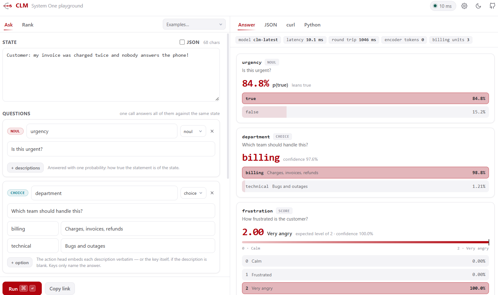

> **[中文化] CLM**
>
> 此项目是 [Contrastive-LM/CLM](https://github.com/Contrastive-LM/CLM) 的中文翻译版本。
> - 原项目 Stars: 2913
> - 主语言: Python
> - 许可证: Apache-2.0
> - 翻译日期: 2026-10-08
> - 原始 README: [README_en.md](README_en.md)
>
> 说明：下方 README 正文为**原项目文档的中文翻译**，力求忠于原文；本页顶部的「中文快速上手」为**面向中文用户的补充导读**（非原文内容），目的是让你不用读完整篇 README 就能先把项目跑起来。
>
> 如有翻译不准确之处，欢迎提 Issue 或 PR。

---


## 🚀 中文快速上手（补充导读，非原文）

### 这是什么 / 解决什么问题

CLM（Contrastive Language Models）是一类用对比学习目标训练的「System One 模型」，把「状态」和「动作」连接起来。本仓库提供 CLM-8B，并把它封装成一个兼容 TypeSafe 的 API。它主要解决决策类任务（如 computer-use、游戏、工具调用）中需要快速、可泛化地打分/排序候选动作的问题，官方称其性能与 Jev 相当，但延迟最多低 9 倍。

### 快速上手（最短路径）

1. 安装（PyPI）：
   ```bash
   pip install contrastive-lm
   ```
   或从克隆安装：
   ```bash
   pip install -e .
   ```
2. 启动编码器（Qwen3-8B embeddings）：
   ```bash
   vllm serve Qwen/Qwen3-8B --served-model-name qwen3-8b --runner pooling --max-model-len 2048 --port 8090 &
   ```
3. 启动 CLM API（默认端口 8700，首次运行会下载 75 MB 的 reference head）：
   ```bash
   clm-serve
   ```
4. 用 Python 客户端提问（示例）：
   ```python
   from clm import CLMClient, Choice, Noul, Score
   client = CLMClient()
   r = client.system_one(
       state="Customer: my invoice was charged twice and nobody answers the phone!",
       questions={
           "urgency": Noul(instructions="Is this urgent?"),
           "department": Choice(instructions="Which team should handle this?",
                                criteria={"billing": "Charges, invoices, refunds",
                                          "technical": "Bugs and outages"}),
           "frustration": Score(instructions="How frustrated is the customer?",
                                criteria=["Calm", "Frustrated", "Very angry"]),
       },
   )
   ```
5. 也可直接排序候选（进程内引擎）：
   ```python
   from clm import Engine
   engine = Engine(emb_url="http://127.0.0.1:8090/v1/embeddings")
   engine.rank("What causes tides on Earth?",
               ["The Moon's gravitational pull.", "Photosynthesis in plants.", "Because the Earth is round."])
   ```
6. 浏览器打开 `http://localhost:8700/` 使用 Playground（远程服务器可用 `ssh -L 8700:localhost:8700 <host>`；只要 API 可加 `--no-ui`）。

### 环境要求

- 操作系统：requirements.txt 注明「Linux + NVIDIA GPU」。
- 硬件：需要 NVIDIA GPU（示例在单张 RTX 4090 上运行 Qwen3-8B 编码器；评测延迟在 H100 上测得）。
- 依赖：Python >= 3.10；主要依赖包括 numpy>=1.24、requests>=2.28、torch>=2.1、fastapi>=0.100、uvicorn>=0.23、vllm>=0.6、pyarrow>=14。
- 版本要求：项目版本 0.1.0，Development Status 为 Alpha。
- 国内网络环境提示：首次运行会从 Hugging Face 下载 reference head（75 MB）及模型，可能需要更换镜像源或加速下载（原文未提供具体镜像配置方法）。

### 常见坑与注意事项

- 需要 GPU：编码器基于 vLLM 运行 Qwen3-8B，requirements.txt 明确假设 Linux + NVIDIA GPU。
- 状态长度限制：超过 2048 tokens 的状态会被截断；如需更长状态，要同时提高 `vllm serve` 的 `--max-model-len` 和 `clm-serve --max-tokens`，且需要更多 GPU 显存。
- 首次运行会下载文件：`clm-serve` 首次运行会下载 75 MB 的 reference head；微调/评测流程还会从 Hugging Face 下载数据集与 checkpoint。
- 可能需要 API Key：客户端示例提到 `CLM_BASE_URL`（默认 http://127.0.0.1:8700）和 `CLM_API_KEY`，但原文未说明 API Key 的具体获取或配置方式。

---


---

<!-- markdownlint-disable MD001 MD041 -->
<p align="center">
  <picture>
    
  </picture>
</p>

<h3 align="center">
对比语言模型
</h3>

<p align="center">
<i>用于快速且可泛化决策的系统一模型</i>
</p>

<p align="center">
| 📄 <a href="https://contrastive-lm.notion.site"><b>博客</b></a> | 🗣️ <a href="https://discord.gg/5dAQEDJBs"><b>Discord</b></a> | 🤗 <a href="https://huggingface.co/Contrastive-LM"><b>数据与模型</b></a> | 📚 <a href="#api-reference"><b>API 参考</b></a> | 🛠️ <a href="#fine-tuning-clm-on-your-own-data"><b>微调教程</b></a> |
</p>

🔥 **对比语言模型（CLM）** 是一类全新的**系统一模型**，通过连接**状态与动作**的**对比学习**目标进行训练。本仓库以 TypeSafe 兼容的 API 提供 **CLM-8B** 服务。

- **CLM-8B** 在 **6000 万条 Nemotron 问答对**上进行预训练，在 **3000 万条合成困难负样本**上进行中期训练，并在 **100 万条智能体轨迹**上进行后训练。
- 在计算机操作、游戏和工具调用任务上，它的表现与 **Jev** 相当，同时延迟最多降低 **9 倍**。经过轻量级微调后，它在智能体编程基准测试中作为验证器创下新的 SOTA：**Terminal-Bench 2.1（87.6%）** 和 **DeepSWE（81.6%）**。
- **状态与动作被解耦**，因此它们的嵌入可以独立缓存和复用，这使得训练和推理既廉价又极速！

我们邀请社区将其接入自己的智能体和基准测试中！

---

## 安装

```bash
pip install contrastive-lm
```

从克隆的仓库安装最新版本：

```bash
pip install -e .
```

---

## 快速开始

### 启动服务

```bash
# 1. 编码器（Qwen3-8B 嵌入）
vllm serve Qwen/Qwen3-8B --served-model-name qwen3-8b --runner pooling --max-model-len 2048 --port 8090 &

# 2. 在 :8700 上运行 CLM API（首次运行时下载 75 MB 的参考头）
clm-serve
```

超过 2048 个 token 的状态会被截断。对于更长的状态，请同时提高两个限制，例如在 `vllm serve` 上设置 `--max-model-len 8192`，并在 `clm-serve` 上设置 `--max-tokens 8192`（需要更多 GPU 内存）。

### 对状态提出类型化问题

```python
from clm import CLMClient, Choice, Noul, Score

client = CLMClient()                          # CLM_BASE_URL（默认 http://127.0.0.1:8700）、CLM_API_KEY
r = client.system_one(
    state="Customer: my invoice was charged twice and nobody answers the phone!",
    questions={
        "urgency": Noul(instructions="Is this urgent?"),
        "department": Choice(instructions="Which team should handle this?",
                             criteria={"billing": "Charges, invoices, refunds",
                                       "technical": "Bugs and outages"}),
        "frustration": Score(instructions="How frustrated is the customer?",
                             criteria=["Calm", "Frustrated", "Very angry"]),
    },
)
print(r.answers["urgency"].noul)                # 0.41022     该陈述为真的概率
print(r.answers["department"].choice)           # billing
print(r.answers["department"].probabilities)    # {'billing': 0.93878, 'technical': 0.06122}
print(r.answers["frustration"].score)           # 1.98386     期望等级，0..2
print(r.usage.input_tokens, r.latency_ms)       # 38 58.1     （冷缓存时为 106 个 token：选项文本只嵌入一次）
```

问题可以是 `Noul` / `Choice` / `Score` 对象，也可以是纯传输格式的字典，因此为 TypeSafe 编写的请求可以直接以 `client.system_one(state, questions)` 重放。

### 直接对候选进行排序

`system_one` 构建在一个原语之上：针对状态对候选进行评分。对于自由形式的候选（best-of-N 答案、工具名称、下一步动作），请使用进程内引擎的 `rank`：

```python
from clm import Engine

engine = Engine(emb_url="http://127.0.0.1:8090/v1/embeddings")     # 参考头，缺失时自动下载
engine.rank("What causes tides on Earth?",
            ["The Moon's gravitational pull.", "Photosynthesis in plants.", "Because the Earth is round."])
# [{'rank': 1, 'candidate': "The Moon's gravitational pull.", 'prob': 0.997}, ...]

engine.answer(state, questions)      # 与 HTTP 端点返回的字典相同，无需服务器
```

---

## 演练场

`clm-serve` 还会在 `/` 提供一个 Web UI（默认 `http://localhost:8700/`）。编写一个状态，添加类型化问题，即可查看 CLM 的答案分布；每个请求也会以 JSON、`curl` 和 Python 的形式展示。**Rank** 标签页可对任意候选集进行排序，且链接可分享。

<p align="center">
  <picture>
    
  </picture>
  <br>
  <sub>针对真实的 <code>clm-serve</code> 截取（<code>clm-latest</code>，Qwen3-8B 编码器运行在一块 RTX 4090 上）。</sub>
</p>

远程服务器？`ssh -L 8700:localhost:8700 <host>`。仅 API：`clm-serve --no-ui`。

---

## 结果

### 零样本评估

<p align="center">
  
</p>

在**计算机操作、游戏和工具调用任务**中，CLM-8B 的表现与 Jev 相当，同时运行速度**最多快 9 倍**。当候选动作数量较多（WikiRacing）或动作在多个状态间被复用时（T-Rex 游戏），加速最为显著。T-Rex 基准测试随本仓库提供：参见 [examples/t_rex](examples/t_rex/README.md)。

### 智能体基准测试：CLM 作为验证器

<p align="center">
  
</p>

对于每个任务，我们采样若干候选解决方案（DeepSWE 使用 **Opus 5**，Terminal-Bench 2.1 使用 **Fable 5**），由 CLM 或 Jev 作为验证器挑选最佳方案。在 **38 个留出的 DeepSWE 任务**和 **30 个留出的 Terminal-Bench 2.1 任务**上评估；延迟基于 H100 测量。对于这些长时程任务，Jev 无法作为验证器，得分低于 pass@1。经过轻量级微调后，CLM 在两者上均达到 SOTA（**81.6%** 和 **87.6%**），同时比 Jev **快 4.1–5.7 倍**。

---

## 在你自己的数据上微调 CLM

参见 [docs/FINETUNING.md](docs/FINETUNING.md)。

```bash
# 复现任务不相交的 DeepSWE heldout-38 结果（31/38 = 81.6%）
hf download Contrastive-LM/deepswe-clm-heads-8k --local-dir heads/deepswe
python evaluation/bon_eval.py --hf-dataset Contrastive-LM/deepswe-clm-embeddings-8k \
    --checkpoint heads/deepswe/best_head.pt \
    --tasks-file heads/deepswe/heldout_tasks.json --n 4 --window 12

# 微调匹配的 DeepSWE 头
python train/finetune.py --task clm --init-ckpt "$(clm-download)" --out-dir runs/deepswe \
    --holdout-tasks heads/deepswe/heldout_tasks.json --batch 512

# 类型化决策
python train/finetune.py --task choice --data LocalLLaMA/typed-decisions --workflow all \
    --init-ckpt "$(clm-download)" --out-dir runs/typed
```

---

## 工作原理

### 简介

CLM 首先在大规模数据集上以对比目标（InfoNCE）训练一个**状态编码器**和一个**动作编码器**，使每个状态被拉向所采取的 ground-truth 动作，并远离所有其他动作。随后，这两个编码器直接充当零样本动作分类器：在部署时，给定当前状态和一组候选动作，CLM 根据每个动作的嵌入与状态嵌入的对齐程度进行评分，并选择得分最高的动作。

这正是本包所提供的功能。一个类型化问题就是一个状态加上一组封闭的候选动作（选项及其描述）；对 CLM 得分做 softmax *就是*答案分布，同一次调用即可对 best-of-N 轨迹排序、路由工具、筛选检索池，并以零任务配置回答类型化决策。

**架构、数据配方与缩放定律：**

- 每个编码器都是一个冻结的 LLM 主干加上一个 2000 万参数的可训练投影头，因此推理时每个新文本只需一次嵌入，每个缓存候选只需一次点积。
- CLM 在互联网规模的问答上**预训练**，在合成困难负样本上**中期训练**，在智能体轨迹上**后训练**，并且可以轻松地在下游任务上微调（[数据配方](#data-recipe)）。
- InfoNCE 损失随训练算力、模型规模和数据集规模**可预测地按幂律下降**（[详情](#scaling-laws-for-verification)）。

```
browser ──► clm-serve  (CPU, :8700)   GET / (playground)
client  ──►                          POST /v1/systemone · GET /v1/models · GET /health
               │       state head + action head (20M params, hot-reloaded), embedding cache
               ▼
          vLLM Qwen3-8B pooling server (GPU, :8090)   /v1/embeddings
```

### 训练算法

CLM 使用双向 InfoNCE 损失进行训练。给定一批 $B$ 个匹配的状态–动作对，我们计算一个 $B \times B$ 的相似度矩阵，并对每个正样本对 $(s_i, a_i)$ 优化双向检索（$s_i \rightarrow a_i$ 和 $a_i \rightarrow s_i$）：

```math
L_{\mathrm{CLM}} = -\frac{1}{2B}\sum_i \left[ \log \frac{\exp\left(s_i^\top a_i/\tau\right)} {\sum_j \exp\left(s_i^\top a_j/\tau\right)} + \log \frac{\exp\left(a_i^\top s_i/\tau\right)} {\sum_j \exp\left(a_i^\top s_j/\tau\right)} \right]
```

对于中期训练，目标函数扩展了困难负样本。令 $h_{ik}^{(a)}$ 表示状态 $s_i$ 的一个困难负样本动作；状态到动作方向变为

```math
L_{s \rightarrow a}^{\mathrm{hard}}=-\frac{1}{B}\sum_i\log\frac{\exp\left(s_i^\top a_i / \tau\right)}{\exp\left(s_i^\top a_i / \tau\right)+\sum_k\exp\left(s_i^\top h_{ik}^{(a)} / \tau\right)}.
```

### 验证的缩放定律

测试 InfoNCE 损失 $L$ 随训练算力 $C$、数据集规模 $D$、投影头规模 $N$ 和编码器规模 $N_{\mathrm{enc}}$ 按幂律缩放。为获得最佳验证性能，这些维度必须联合缩放；当某个缩放因子不受其他因子瓶颈限制时，对每个变量 $`X \in \{C, D, N, N_{\mathrm{enc}}\}`$ 的依赖关系为

```math
L(X) \approx \left(\frac{X_c}{X}\right)^{\alpha_X},
```

其中 $X_c$ 是拟合的缩放常数，$\alpha_X$ 是对应的缩放指数，遵循 Kaplan 等人的工作。缩放编码器规模带来的收益最强。实验在 Nemotron DQA 数据集上进行，并在留出集上评估；拟合结果和图表见[博客文章](https://contrastive-lm.notion.site)。

**数据与最优模型规模。** 在固定算力预算下，测试损失相对于头规模的每条等 FLOP 曲线在 log 参数空间中都能很好地用抛物线近似，其最小值给出了该数据预算下的最优头规模。最优点几乎与训练 token 数量呈线性增长，$N^* \propto D^{1.02}$，大约为**每参数 310 个 token**。

### 数据配方

CLM 分三个阶段训练，每个阶段都是难度递增的状态–动作对齐形式：

1. **预训练**：在**约 6000 万条 Nemotron DQA 问答对**上，每个问题为状态，其答案为动作。这学习到广泛的语义表示。
2. **中期训练**：在由 Gemini 2.5 Flash-Lite 生成的**约 3000 万条合成困难负样本**上——即对 Nemotron DQA 问题语义相似但错误的答案，按上述方式加入 InfoNCE 损失。这培养了对合理动作之间细粒度区分的能力。
3. **后训练**：在来自 Agent Data Protocol（ADP）数据集的**约 100 万条智能体轨迹**上，外加来自 Endless-Terminals 和 LiteCoder-Terminal-SFT 的终端轨迹。每个轨迹步骤都是一个状态–动作对：智能体的当前上下文及其所做的决策。

**后训练期间的重放。** 后训练混合数据中 40% 是 Nemotron DQA 重放，60% 是智能体轨迹。使用重放时，Nemotron 困难负样本 top-1 准确率仅从 69% 变为 68.5%；在相同智能体步数下仅用智能体数据训练，则降至 56.2%。

**为什么不从一开始就用困难负样本训练？** 在约 10 万个留出问题（每个 1 个金标准答案、10 个困难负样本）上，仅预训练在未见过困难负样本的情况下达到 **52.1%** top-1，而一个简短的中期训练阶段将其提升至 **69.2%**。从一开始就用困难负样本训练提升很快，但在过拟合前峰值仅为 **62.4%**，因此在固定预算下两阶段配方**好 7 个百分点**：困难负样本最好作为预训练之上的精炼，而非其替代品。

作为 `clm-latest` 提供的参考头是 [Contrastive-LM/CLM-v0.1-8B](https://huggingface.co/Contrastive-LM/CLM-v0.1-8B)（`CLM_v0.1-8B.pt`，Qwen3-8B 主干，last-token 池化）。任何相同检查点格式的头——一个包含 `state_head` / `action_head` state dict、`logit_scale` 和 `cfg`（`width`、`depth`、`projection_dim`、`activation`、`layernorm`、`residual`）的 `torch.save` 字典——都可以用 `--ckpt` 提供服务；头只有与其训练时所用的编码器和池化方式搭配才有意义。

---

## 路线图

1. **缩放实验：** 更大的主干，以及验证性能还能扩展到多远。
2. **视觉与多模态支持：** 用于机器人和计算机操作任务的图像、视频及其他模态。
3. **扩展数据配方：** 更多预训练、困难负样本挖掘和智能体后训练。

---

## 引用

如果你觉得 CLM 有用，请考虑引用它：

```bibtex
@misc{kwok2026contrastivelanguagemodels,
  title={Contrastive Language Models},
  author={Jacky Kwok and Hangoo Kang and Tarun Suresh and Jon Saad-Falcon and Marco Pavone and Christopher Ré and Azalia Mirhoseini},
  year={2026},
  note={Notion Blog},
  url={https://contrastive-lm.notion.site}
}
```

## 许可证

本仓库中的代码在 [Apache 2.0 许可证](LICENSE)下发布。CLM-8B 权重在 [Hugging Face](https://huggingface.co/Contrastive-LM/CLM-v0.1-8B) 上以 Apache 2.0 发布。

---

## 目录结构

```
.
├── pyproject.toml               # clm 包（由 requirements.txt 以可编辑模式安装）
├── serve_qwen3_8b.sh            # 在 GPU 上启动 Qwen3-8B 池化编码器
├── download_head.sh             # 获取已发布的头（`clm-download` 作用相同）
├── assets/                      # logo + 上文使用的演练场截图
├── src/clm/                     # 推理：`clm-serve` 和
```